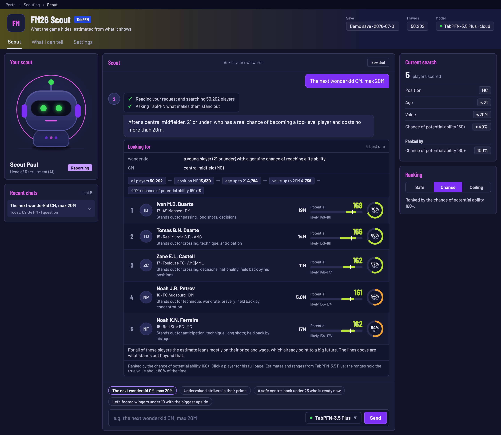
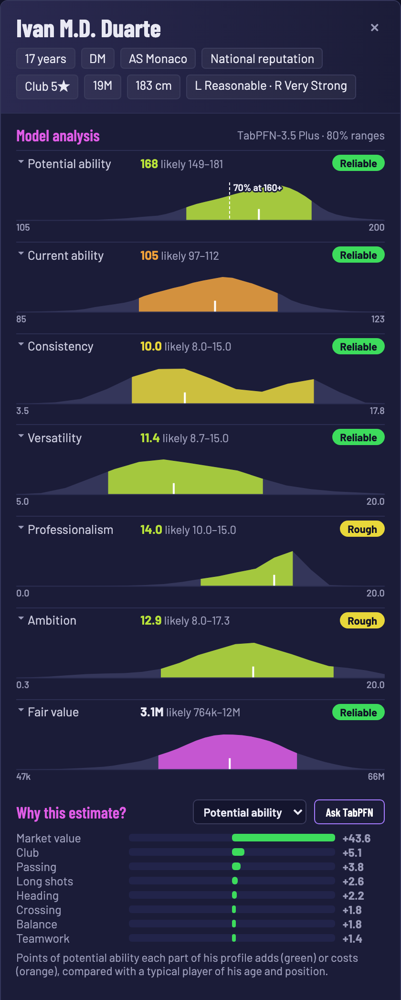
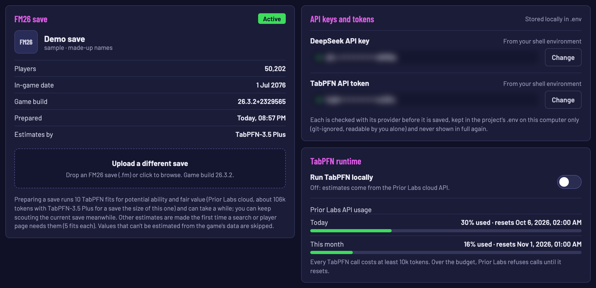
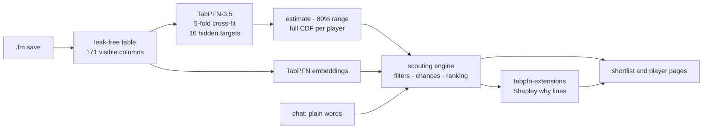
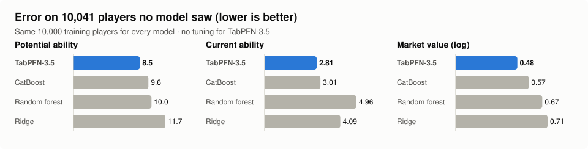
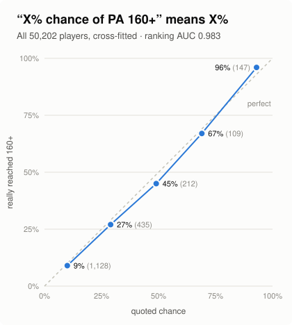
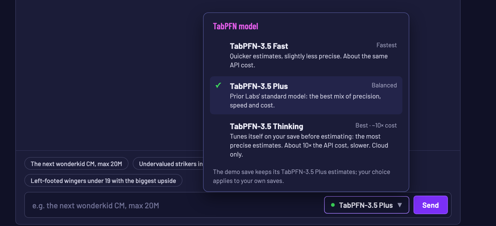

# FM26 Scout

**The scout that sees what Football Manager hides, powered end to end by TabPFN-3.5.**

Ask in plain words, *"Find me the next wonderkid for central midfield, max 20M"*, and get a
shortlist where every player has an estimate of his hidden potential, an 80% range, a calibrated
chance of becoming world class, a curve of TabPFN's full predictive distribution and a Shapley
"why". No training loop, no tuning, no game memory hacks: a foundation model reads the same
screen you do and tells you what is behind it.

[](LICENSE)
[](https://docs.priorlabs.ai)




## The problem

[Football Manager](https://www.footballmanager.com) is a football management game: you run a club,
set tactics, develop players, manage the finances and, above all, **scout and recruit**. It is
jokingly called a **"spreadsheet simulator"**: behind the match engine sits a huge structured
database of players, clubs, attributes and statistics. That makes it a natural home for tabular
machine learning.

Each of its tens of thousands of players has 47 visible attributes on a 1-20 scale, but the
numbers that matter most are **hidden**:

- **Potential ability (PA)**: how good a young player can become (1-200).
- **Current ability (CA)**: how good he is today, on the same scale.
- **Personality and hidden attributes**: consistency, professionalism, ambition, big-match temperament and more.

The game gives only clues: scout reports, star ratings, a coach's opinion. The true values sit in
the save file, and reading them with an editor kills the uncertainty that makes scouting fun.
**FM26 Scout behaves like a data-driven scout instead**: it learns from tens of thousands of
players how what you can see relates to what you can't, and estimates the hidden values for every
player in your save, with an honest range.

That is a textbook tabular problem: one table of 171 visible columns (numbers, in-game labels,
categories, missing values), 16 hidden targets, and a new dataset with every save. A conventional
pipeline needs training, tuning and feature engineering per target and per save. **TabPFN-3.5
learns each target in a single fit**, which makes scouting in a chat practical.

## What you get

| | |
|---|---|
| **Estimates for every hidden number** | PA, CA, consistency, versatility, professionalism, ambition and fair market value, for all 50,202 players of a save |
| **Ranges that hold** | 80% ranges that contain the truth 80-86% of the time on the reliable targets |
| **Chances you can trust** | read off TabPFN's predictive distribution: players quoted 69% for PA 160+ got there 67% of the time |
| **The whole distribution** | a density curve per estimate on the player page, with the 80% band and your threshold |
| **A "why" for every player** | Shapley values from Prior Labs' TabPFN explainer: what makes him better or worse than his peers |
| **Players like X** | TabPFN embeddings find players of the same level, mixed with the attribute profile for the same role |
| **A chat in the FM26 style** | plain words in, a validated search out; follow-ups like "only left-footed" or "cheaper" |
| **Your own save** | upload a `.fm` file in Settings: potential and fair value are ready in minutes, the rest when first needed |



*Each estimate on the player page is one row; click it and TabPFN's predictive distribution folds
open below it.*

## Built on the Prior Labs ecosystem

FM26 Scout uses TabPFN-3.5 everywhere a number is estimated, and the Prior Labs tools around it:

| Prior Labs component | How FM26 Scout uses it |
|---|---|
| **TabPFN-3.5** (`TabPFNRegressor`) | One model per hidden target, cross-fitted in 5 folds over every player. The raw table goes in as it is: 171 columns, categoricals declared natively, missing values left missing. |
| **Predictive distributions** (`output_type="quantiles"`) | One call at 63 quantile levels per fold gives the estimate, the 80% range and each player's whole CDF. 10,000 players in about 11 seconds. |
| **TabPFN-3.5 Plus** (cloud default) | The default model behind every estimate in the cloud. |
| **TabPFN-3.5 Fast** | One click in the model picker: about 1.7× less server compute. |
| **TabPFN-3.5 Thinking** (`thinking_effort`, `thinking_metric="mae"`) | Prior Labs' thinking mode spends extra compute on every fit; ranges come from a default fit centred on the thinking estimate. |
| **Prior Labs API** (`tabpfn-client`) | The default backend: no GPU needed. Each estimate is made once per save and cached, so re-ranking and follow-ups cost nothing. |
| **Cost and usage API** (`estimate_cost`, usage endpoint) | A token quote before every upload or model switch; today's and this month's usage in Settings. |
| **Rate limits** | 429s are retried after `Retry-After`; Thinking is paced to 10 fits a minute and 30 an hour. |
| **Local TabPFN** (`tabpfn`, CUDA / Apple MPS / CPU) | One switch in Settings runs everything on your own machine; the KV cache (`fit_mode="fit_with_cache"`) reuses one fit for every Shapley coalition. |
| **Embeddings** (`get_embeddings`) | The similarity space behind "players like X". |
| **tabpfn-extensions: interpretability** (`get_tabpfn_imputation_explainer`) | Shapley values against a typical peer; all coalitions of a shortlist in one batched call. |





## Results

All numbers are on the sample save in this repository (50,202 players) and can be reproduced
with the commands below.



**TabPFN-3.5 is better than CatBoost, random forest and ridge on 15 of 16 hidden targets**, out
of the box, with every model trained on the same 10,000 players and a 95% bootstrap interval over
10,041 held-out players. The 16th, adaptability, is a tie: no model does better than a median
guess there ([full benchmark](reports/sample/benchmark.md)).

| Target | TabPFN-3.5 error | Best rival | TabPFN − rival (95% CI) | R² |
|---|---|---|---|---|
| Potential ability (1-200) | **8.48** | 9.56 CatBoost | −1.09 (−1.18, −0.99) | **0.890** |
| Current ability (1-200) | **2.82** | 3.01 CatBoost | −0.20 (−0.24, −0.16) | **0.987** |
| Market value (log) | **0.48** | 0.57 CatBoost | −0.089 (−0.098, −0.078) | **0.927** |
| Consistency (1-20) | **1.80** | 1.82 CatBoost | −0.019 (−0.027, −0.011) | 0.65 |
| Versatility (1-20) | **1.48** | 1.50 CatBoost | −0.015 (−0.022, −0.008) | 0.71 |

**More data does not buy the rivals the lead where it counts.** Given 4× the training rows
(40,000), CatBoost still trails TabPFN-3.5 on potential ability (8.91 vs 8.48), and with all
21,004 known values of the training split it still trails on market value (0.535 vs 0.478). Only on current
ability, the easiest target, does CatBoost on 4× the rows edge ahead (2.56 vs 2.82).



**Chances mean what they say.** Every player's chance of PA 160+ is read off his own predictive
distribution. Players quoted around 10% really got there 9% of the time, around 50% 45%, around
93% 96%. As a ranking it finds the needles: only 1.2% of players reach PA 160+, yet the chance
ranks them with **AUC 0.983** and average precision 0.66. Among under-21s, where the base rate is
0.8%, the 50 highest chances hold **39 future 160+ players** ([trust report](reports/sample/trust.md)).

**Ranges that hold.** Every player is predicted by a model that never saw his hidden values
(5-fold cross-fitting). The 80% ranges contain the true value 83% of the time for PA and 86% for
CA, and they are informative: for PA the players with the narrowest ranges are off by 5.6, the
widest by 11.4. The scout exposes only the 7 targets the trust report rates reliable or rough.

**Explanations that add up and hold still.** The Shapley why lines add up exactly to "estimate
minus peer estimate". At the app's budget, two runs with different seeds name the same top reason
for all 20 test players; a quarter of that budget still names it for 18 of 20. And they point at
what matters: swapping the four named parts of a profile for a typical peer's moves the estimate
6.0 points, against 3.6 for TabPFN's missing-value explainer
([`shap.json`](reports/sample/shap.json), [`scripts/bench_shap.py`](scripts/bench_shap.py)).

**Fast.** All 16 targets for all 50,202 players, 80 TabPFN fits with full distributions, in
about 30 minutes through the Prior Labs API. An uploaded save is ready for scouting after 10 fits.

<br clear="right">

## Why TabPFN-3.5 is the right model for this

- **A new model in one call.** Every save is a new dataset and every hidden value a new task. With
  TabPFN-3.5 a target the chat needs for the first time is fitted while you wait: no training loop,
  no hyperparameters, no feature engineering.
- **Uncertainty is native.** Ranges, chances and the density curves all come from the predictive
  distribution TabPFN already returns. Nothing is bolted on.
- **The raw table is enough.** In-game labels, categories, 61 trait flags and missing market
  values go in as they are.
- **One model, three dials.** Fast, Plus and Thinking, in the cloud or on a laptop GPU, behind one
  class (`models.TabPFN`) and one model picker.

## The chat

> **You:** Looking for the next wonderkid for central midfield, max 20M
>
> **Scout:** Central midfielders aged 21 or under, priced up to 20M, ranked by how likely they are
> to reach a top-level ceiling. If you want a different price ceiling or to include defensive
> midfielders, say so.
>
> *all players 50,202 → position MC: 13,839 → age up to 21: 4,784 → value up to 20M: 4,738 →
> 40%+ chance of potential ability 160+: **5***

The planner turns your words into a search spec, and the engine runs it. Each answer shows how it
read your words, the funnel (how many players each step kept) and five compact rows: price,
estimate with range, chance and a why line. Follow-ups edit the current search ("only
left-footed", "cheaper"), "tell me about the second one" opens his page, and "players like him"
uses TabPFN embeddings. The language model never sees training data and never states a number:
code validates every spec by running it, and every number on the page comes from TabPFN.



## Quick start

```sh
git clone https://github.com/m-herre/fm26-scout && cd fm26-scout
conda env create -f environment.yml && conda activate fm26-scout   # or: pip install -e ".[local,bench,dev]"
fm26 web                             # http://127.0.0.1:8626
```

`fm26 web` opens on the **demo save**: 50,202 players of an FM26 save (build `26.3.2`) with
made-up names and every estimate already made, so it works at once, **even without any key**: the
four example questions replay a recorded chat answer, and their shortlists come with TabPFN's
Shapley why lines already computed. To ask your own questions, paste a free
[Prior Labs](https://ux.priorlabs.ai) TabPFN token and a DeepSeek key in **Settings** (each is
checked, then kept in the git-ignored `.env` and only shown masked); there you can also upload your
own `.fm` save. Install it editable (`-e`), as above: the app keeps `sample/`, `data/` and
`reports/` next to the code.

Without any key, straight from the terminal:

```sh
fm26 card "Novak"                    # everything the scout can tell about one player
fm26 search docs/example_search.json # a search spec -> ranked shortlist + saved report
fm26 schema                          # every column and whether a model may see it
```

**Run TabPFN on your own machine:** Settings › Run TabPFN locally, or `FM26_TABPFN=local`
(`FM26_TABPFN_DEVICE=cpu|cuda|mps`). The TabPFN-3.5 weights download once into
`data/tabpfn-weights` after you accept the licence with your Prior Labs account.

### Your own save

Upload it in Settings, or on the command line:

```sh
fm26 extract <save>.fm                              # -> data/<save>/players.parquet
fm26 predict   --data data/<save>/players.parquet   # all 16 targets, ranges, CDFs, trust report
fm26 embed     --data data/<save>/players.parquet   # similarity vectors (local TabPFN)
fm26 benchmark --data data/<save>/players.parquet   # TabPFN-3.5 vs four baselines
```

### Reproduce the numbers

```sh
fm26 benchmark --more-rows 40000     # reports/sample/benchmark.md, rivals also on 4x the rows
fm26 predict                         # sample/predictions.parquet, CDFs, trust.md (80 fits, ~1M tokens)
fm26 trust                           # trust report from the stored predictions, no fit
python scripts/bench_shap.py         # Shapley why lines: stability, deletion test
python scripts/make_charts.py        # the charts in this README, from the reports
pytest                               # 65 tests, no network
```

## Built to be trusted

- **Leak-free by construction.** `schema.py` registers every column as visible, hidden or meta.
  Hidden values are targets only; a test corrupts every held-out hidden value and checks that no
  prediction changes, and the engine drops all hidden columns when it loads.
- **What the game shows, nothing more.** Where FM shows a label (position familiarity, foot
  strength, reputation, club stars), the model gets the label, not the stored number.
- **Only what it can back up.** The trust report rates every target; the scout filters and ranks
  only on the 7 rated reliable or rough.
- **Every search is saved** as JSON with the funnel, predictions, ranges and explanations.

## Search specs

```json
{"filters": {"age": [null, 20], "position": ["STC"], "value": [null, 8000000]},
 "chance": {"target": "potential_ability", "at_least": 160, "min": 0.4},
 "rank": {"pred_potential_ability": 0.7, "pace": 0.15, "acceleration": 0.15},
 "risk": 0.2, "like": "Novak", "limit": 5, "explain": "potential_ability"}
```

Filters are hard ([min, max] or allowed values). `chance` keeps players whose predictive
distribution gives at least `min` probability of reaching `at_least`. Rank weights apply to
standardised columns: any visible attribute, `pred_<target>`, `chance`, `value_gap` (fair value
vs price), `pa_vs_peers` and `similarity` (with `like`). `risk` penalises wide ranges.
`explain` adds Shapley why lines for the shortlist.

## Layout

| File | Role |
|---|---|
| `schema.py` | column registry, targets, `feature_columns()` |
| `split.py` | the fixed, stratified benchmark split |
| `extract.py` | save → canonical table; anonymised sample |
| `models.py` | one `TabPFN` class: cloud or local, Fast / Plus / Thinking, distributions, embeddings |
| `quota.py` | Prior Labs cost quotes, usage, rate limits and retries |
| `predict.py` | cross-fitted predictions, chances from the CDF, trust report |
| `prepare.py` | save → ready folder, for the command line and the web upload |
| `analytics.py` | similarity space, peer comparison, Shapley explanations |
| `scout.py` | the engine: filters, chances, ranking, player pages, saved reports |
| `settings.py` | API keys, local or cloud runtime, the `.env` file |
| `agent.py` | the planner: words → questions or a search spec, with guard rails |
| `web.py`, `static/index.html` | the chat: standard-library server, one page in the FM26 style |
| `benchmark.py`, `cli.py` | `fm26 benchmark` and every other `fm26` command |

## Licence

The code is Apache 2.0 ([LICENSE](LICENSE)). Football Manager is a trademark of Sports Interactive
and SEGA; this project is not affiliated with them.

TabPFN-3.5 is not part of this repository. Its model weights are under Prior Labs'
[TABPFN-3.5 License v1.0](https://huggingface.co/Prior-Labs/tabpfn_3_5/blob/main/LICENSE)
([models](https://docs.priorlabs.ai/models)); local runs download them into the git-ignored
`data/tabpfn-weights`. Cloud runs use the Prior Labs API under Prior Labs'
[terms](https://www.priorlabs.ai/general-terms-and-conditions); the chat uses the DeepSeek API
under DeepSeek's terms.

## Data and rights

`sample/` comes from one FM26 save that a player shared publicly on Reddit
([r/footballmanagergames](https://www.reddit.com/r/footballmanagergames/comments/1vogip3/heres_an_fm26_save_on_01072076_if_you_wanna/)),
build `26.3.2+2329565`, in-game date 1 July 2076. Fifty years into the career, every one of its
50,202 players was generated by the game: none is a real footballer. The repository holds only the
derived player table, not the save, and every name was replaced with a made-up one
(`extract.anonymise`). Football Manager and its database belong to Sports Interactive and SEGA;
the sample is shared non-commercially so that every number here can be reproduced, and it will be
removed on request. Prices and fair values are in the save's own money units, shown as k and M.

## Credits

- [TabPFN-3.5](https://docs.priorlabs.ai), the Prior Labs API and
  [tabpfn-extensions](https://github.com/PriorLabs/tabpfn-extensions) by Prior Labs.
- [`fmsave`](https://github.com/rhiever/fmsave) by Randal S. Olson (MIT) reads the FM26 save.
- [DeepSeek](https://www.deepseek.com) turns the chat into search specs.
